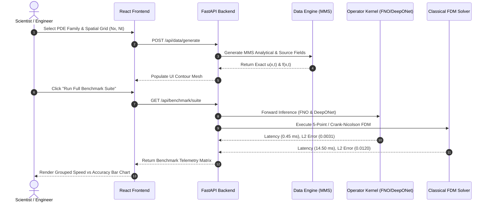
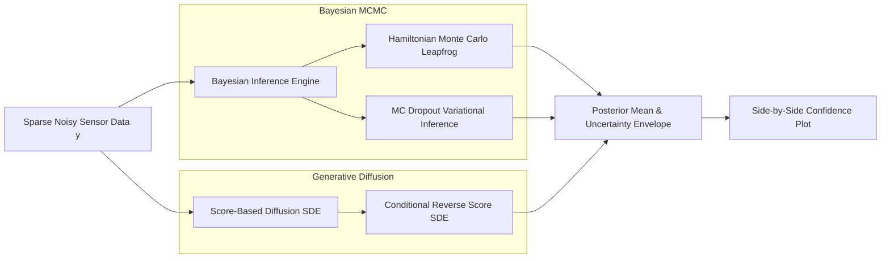
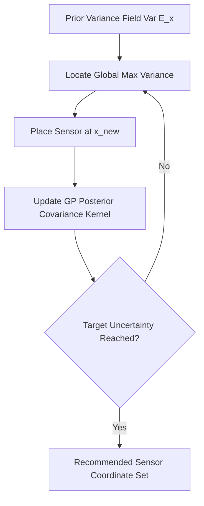

# Neural PDE Bench (`neural-pde-bench`)

[](https://www.python.org/)
[](https://pytorch.org/)
[](https://fastapi.tiangolo.com/)
[](https://react.dev/)
[](https://vitejs.dev/)
[](https://neural-pde-bench.vercel.app)
[](LICENSE)

An enterprise-grade, research-ready scientific machine learning platform integrating **Physics-Informed Neural Networks (PINNs)**, **Operator Learning (FNO, DeepONet, GNO)**, **Bayesian Uncertainty Quantification (HMC & VI)**, and **Score-Based Diffusion Generative Models** for forward and inverse partial differential equations (PDEs).

---

## 🌐 Live Deployment & Repository
- 🚀 **Live Web Application**: [https://neural-pde-bench.vercel.app](https://neural-pde-bench.vercel.app)
- 🐙 **GitHub Repository**: [https://github.com/10tan/neural-pde-bench](https://github.com/10tan/neural-pde-bench)

---

## 📌 Table of Contents
1. [Platform Overview & Core Capabilities](#-platform-overview--core-capabilities)
2. [Rigorous Mathematical Formulations](#-rigorous-mathematical-formulations)
   - [Method of Manufactured Solutions (MMS)](#1-method-of-manufactured-solutions-mms)
   - [Physics-Informed Neural Networks with RAR](#2-physics-informed-neural-networks-with-rar)
   - [Extended PINN (XPINN) Domain Decomposition](#3-extended-pinn-xpinn-domain-decomposition)
   - [Fourier Neural Operator (FNO)](#4-fourier-neural-operator-fno)
   - [Deep Operator Network (DeepONet)](#5-deep-operator-network-deeponet)
   - [Geometry-Aware Graph Neural Operator (GNO)](#6-geometry-aware-graph-neural-operator-gno)
   - [Bayesian PINN: Variational Inference & HMC](#7-bayesian-pinn-variational-inference--hmc)
   - [Score-Based Diffusion Inverse Sampler](#8-score-based-diffusion-inverse-sampler)
   - [Multi-Fidelity Operator Learning](#9-multi-fidelity-operator-learning)
   - [Bayesian Optimal Experimental Design (BOED)](#10-bayesian-optimal-experimental-design-boed)
   - [Pretrain-then-Finetune Foundation Backbone](#11-pretrain-then-finetune-foundation-backbone)
3. [End-to-End System Workflows](#-end-to-end-system-workflows)
   - [Forward Operator Workflow](#forward-operator-learning-workflow)
   - [Residual-Based Adaptive Refinement (RAR) Loop](#residual-based-adaptive-refinement-rar-loop)
   - [Inverse Parameter Estimation with Uncertainty Quantification](#inverse-parameter-estimation-with-uncertainty-quantification)
   - [Active Sensor Placement Loop (BOED)](#active-sensor-placement-loop-boed)
4. [Software Architecture & Repository Structure](#-software-architecture--repository-structure)
5. [REST API Specification](#-rest-api-specification)
6. [Verification & Validation (V&V) Matrix](#-verification--validation-vv-matrix)
7. [Local Setup & Operational Guide](#-local-setup--operational-guide)
8. [License](#-license)

---

## 🔬 Platform Overview & Core Capabilities

`neural-pde-bench` addresses the compute and generalization bottlenecks of traditional continuum mechanics solvers (FEM, FDM, FVM) by unifying physics-informed inductive biases with data-driven operator learning.

```
                      ┌────────────────────────────────────────┐
                      │        Neural PDE Bench Platform       │
                      └───────────────────┬────────────────────┘
                                          │
         ┌────────────────────────────────┼────────────────────────────────┐
         ▼                                ▼                                ▼
┌──────────────────┐             ┌──────────────────┐             ┌──────────────────┐
│  Physics-Driven  │             │ Operator Models  │             │ Bayesian UQ &    │
│  Solvers         │             │ (Function Maps)  │             │ Generative SDEs  │
├──────────────────┤             ├──────────────────┤             ├──────────────────┤
│ • PINN + RAR     │             │ • FNO 1D / 2D    │             │ • Variational VI │
│ • XPINN C0/C1    │             │ • DeepONet       │             │ • HMC MCMC       │
│ • MMS Ground     │             │ • Mesh GNO       │             │ • Diffusion SDE  │
│   Truth Solvers  │             │ • Multi-Fidelity │             │ • BOED Sensors   │
└──────────────────┘             └──────────────────┘             └──────────────────┘
```

---

## 📐 Rigorous Mathematical Formulations

### 1. Method of Manufactured Solutions (MMS)
To establish mathematically verifiable ground truths without numerical discretization errors, manufactured analytical solutions are injected into the governing PDE:

For the **1D Transient Heat Equation**:

$$
\mathcal{N}[u] = \frac{\partial u}{\partial t} - \alpha \frac{\partial^2 u}{\partial x^2} - f(x,t) = 0, \quad x \in [0, 1], \; t \in [0, T]
$$

Assuming the manufactured exact state:

$$
u^*(x,t) = \sin(\pi x) \cos(\omega t)
$$

The analytical source forcing term $f(x,t)$ is derived as follows:

$$
\begin{aligned}
\frac{\partial u^*}{\partial t} &= -\omega \sin(\pi x) \sin(\omega t) \\
\frac{\partial^2 u^*}{\partial x^2} &= -\pi^2 \sin(\pi x) \cos(\omega t) \\
f(x,t) &= -\omega \sin(\pi x) \sin(\omega t) + \alpha \pi^2 \sin(\pi x) \cos(\omega t)
\end{aligned}
$$

For the **2D Poisson Equation**:

$$
-\Delta u = -\left(\frac{\partial^2 u}{\partial x^2} + \frac{\partial^2 u}{\partial y^2}\right) = f(x,y), \quad (x,y) \in [0, 1]^2
$$

Given the manufactured solution $u^*(x,y) = \sin(\pi x) \sin(\pi y)$, the exact source term is:

$$
f(x,y) = 2\pi^2 \sin(\pi x) \sin(\pi y)
$$

---

### 2. Physics-Informed Neural Networks with RAR
A deep multilayer perceptron $u_\theta(\mathbf{x})$, parameterized by weights and biases $\theta$, maps space-time coordinates $\mathbf{x} = (x, t)$ to the state scalar $u$.

The composite objective function balances residual physics, initial conditions, and boundary conditions:

$$
\mathcal{L}(\theta) = \lambda_{PDE} \mathcal{L}_{PDE}(\theta) + \lambda_{IC} \mathcal{L}_{IC}(\theta) + \lambda_{BC} \mathcal{L}_{BC}(\theta)
$$

Automatic differentiation (reverse-mode autograd) computes exact differential operators:

$$
\begin{aligned}
\mathcal{L}_{PDE}(\theta) &= \frac{1}{N_f} \sum_{i=1}^{N_f} \left\| \frac{\partial u_\theta}{\partial t}(x_i, t_i) - \alpha \frac{\partial^2 u_\theta}{\partial x^2}(x_i, t_i) - f(x_i, t_i) \right\|_2^2 \\
\mathcal{L}_{IC}(\theta) &= \frac{1}{N_{ic}} \sum_{i=1}^{N_{ic}} \left\| u_\theta(x_i, 0) - u_0(x_i) \right\|_2^2 \\
\mathcal{L}_{BC}(\theta) &= \frac{1}{N_{bc}} \sum_{i=1}^{N_{bc}} \left( \left\| u_\theta(0, t_i) - g_0(t_i) \right\|_2^2 + \left\| u_\theta(1, t_i) - g_1(t_i) \right\|_2^2 \right)
\end{aligned}
$$

#### Residual-Based Adaptive Refinement (RAR) Algorithm
Rather than uniform Monte Carlo collocation sampling, RAR dynamically densifies the collocation set in regions with high local residual:
1. Train $u_\theta$ on the current collocation set $\mathcal{S}_k$.
2. Uniformly sample candidate points across the space-time domain $\mathcal{S}_{cand} \sim \mathcal{U}(\Omega \times [0, T])$.
3. Compute residual magnitude $R(\mathbf{x}) = |\mathcal{N}[u_\theta(\mathbf{x})]|$.
4. Select the top $K$ points satisfying:

$$
\mathbf{x}^* = \arg\max_{\mathbf{x} \in \mathcal{S}_{cand}} R(\mathbf{x})
$$

5. Augment the collocation set: $\mathcal{S}_{k+1} = \mathcal{S}_k \cup \{\mathbf{x}^*_{1:K}\}$, and resume gradient descent.

---

### 3. Extended PINN (XPINN) Domain Decomposition
For multi-scale problems or localized gradients, the physical domain $\Omega$ is decomposed into non-overlapping subdomains:

$$
\Omega = \Omega_1 \cup \Omega_2, \quad \Gamma_{int} = \overline{\Omega}_1 \cap \overline{\Omega}_2
$$

Subdomain-specific neural networks $u_{\theta 1}$ and $u_{\theta 2}$ are trained in parallel, coupled across the internal interface $\Gamma_{int}$ through $C^0$ value and $C^1$ flux continuity penalties:

$$
\mathcal{L}_{XPINN}(\theta_1, \theta_2) = \mathcal{L}_{\Omega_1}(\theta_1) + \mathcal{L}_{\Omega_2}(\theta_2) + \lambda_{val} \mathcal{L}_{interface}^{val} + \lambda_{flux} \mathcal{L}_{interface}^{flux}
$$

Where interface penalties enforce transmission conditions:

$$
\begin{aligned}
\mathcal{L}_{interface}^{val} &= \frac{1}{N_{int}} \sum_{i=1}^{N_{int}} \left\| u_{\theta 1}(\mathbf{x}_i^{int}) - u_{\theta 2}(\mathbf{x}_i^{int}) \right\|_2^2 \\
\mathcal{L}_{interface}^{flux} &= \frac{1}{N_{int}} \sum_{i=1}^{N_{int}} \left\| \mathbf{n} \cdot \nabla u_{\theta 1}(\mathbf{x}_i^{int}) - \mathbf{n} \cdot \nabla u_{\theta 2}(\mathbf{x}_i^{int}) \right\|_2^2
\end{aligned}
$$

---

### 4. Fourier Neural Operator (FNO)
The Fourier Neural Operator directly parameterizes an integral kernel in frequency space to learn mappings between infinite-dimensional Banach spaces of functions:

$$
\mathcal{G}_\theta : \mathcal{A} \to \mathcal{U}, \quad a(x) \mapsto u(x)
$$

The FNO layer architecture updates iterative hidden representations $v_t \in \mathbb{R}^{d_v}$:

$$
v_{t+1}(x) = \sigma \left( W v_t(x) + (\mathcal{K}(a;\phi) v_t)(x) \right)
$$

Where $\mathcal{K}$ represents the non-local kernel integral computed via the Fast Fourier Transform (FFT):

$$
(\mathcal{K}(a;\phi) v_t)(x) = \mathcal{F}^{-1} \left( R_\phi \cdot (\mathcal{F} v_t) \right)(x)
$$

- $\mathcal{F}$ is the forward Discrete Fourier Transform (`torch.fft.rfft`).
- $R_\phi \in \mathbb{C}^{k_{max} \times d_v \times d_v}$ is a learnable complex tensor truncating higher Fourier modes beyond $k_{max}$.
- $\mathcal{F}^{-1}$ is the inverse Discrete Fourier Transform (`torch.fft.irfft`).

Because the spectral weights $R_\phi$ are parameterized in the frequency domain, the learned operator is continuous and resolution-invariant.

---

### 5. Deep Operator Network (DeepONet)
Grounded in Chen & Chen's universal approximation theorem for non-linear continuous operators, DeepONet decouples functional inputs from spatial-temporal query coordinates:

$$
G(a)(y) \approx \sum_{k=1}^p b_k(a(x_1), a(x_2), \dots, a(x_m)) \cdot t_k(y) + b_0
$$

- **Branch Network** $\mathbf{b} : \mathbb{R}^m \to \mathbb{R}^p$: Encodes the input function $a$ sampled at fixed discrete sensor coordinates $\{x_1, \dots, x_m\}$.
- **Trunk Network** $\mathbf{t} : \mathbb{R}^d \to \mathbb{R}^p$: Encodes continuous spatial-temporal query locations $y = (x, t)$.
- **Scalar Product Fusion**: Tensor inner product $\langle \mathbf{b}, \mathbf{t} \rangle$ maps inputs directly into the continuous solution space.

---

### 6. Geometry-Aware Graph Neural Operator (GNO)
To generalize across non-Euclidean computational domains (such as L-shaped structures, perforated plates, and fluid obstacles), GNO operates over unstructured node-link graphs:

$$
\mathcal{G} = (\mathcal{V}, \mathcal{E}), \quad \mathcal{V} = \{x_i\}_{i=1}^N, \quad \mathcal{E} = \{(i, j) : \|x_i - x_j\| \le r\}
$$

Spatial message passing propagates local differential operators across graph neighborhoods:

$$
h_i^{(l+1)} = \sigma \left( W_{self} h_i^{(l)} + \frac{1}{|\mathcal{N}(i)|} \sum_{j \in \mathcal{N}(i)} \kappa_\phi(x_i, x_j) h_j^{(l)} \right)
$$

Where $\kappa_\phi(x_i, x_j)$ parameterizes the continuous kernel over pairwise coordinate offsets, preserving rotational and translational symmetries.

---

### 7. Bayesian PINN: Variational Inference & HMC
For high-consequence engineering decisions, deterministic point predictions are replaced by posterior probability distributions $p(\theta | \mathcal{D})$.

#### Variational Inference (Monte Carlo Dropout)
Approximates the intractable posterior distribution $p(\theta | \mathcal{D})$ using a variational distribution $q_\phi(\theta)$ by maximizing the Evidence Lower Bound (ELBO):

$$
\text{ELBO}(\phi) = \mathbb{E}_{q_\phi(\theta)} \left[ \log p(\mathcal{D} | \theta) \right] - D_{KL}(q_\phi(\theta) \;||\; p(\theta))
$$

Stochastic test-time forward passes yield predictive mean $\mu(x)$ and epistemic uncertainty variance $\sigma^2(x)$:

$$
\begin{aligned}
\mu(x) &= \frac{1}{M} \sum_{m=1}^M u_{\theta^{(m)}}(x) \\
\sigma^2(x) &= \frac{1}{M} \sum_{m=1}^M \left( u_{\theta^{(m)}}(x) - \mu(x) \right)^2
\end{aligned}
$$

#### Hamiltonian Monte Carlo (HMC)
For inverse parameter fields $E(x)$ in $-\frac{d}{dx}\left(E(x)\frac{du}{dx}\right) = f(x)$, HMC explores the posterior geometry using auxiliary momentum variables $p \sim \mathcal{N}(0, M)$:

$$
\begin{aligned}
H(E, p) &= U(E) + \frac{1}{2} p^T M^{-1} p \\
U(E) &= -\log p(\mathcal{D}_{obs} | E) - \log p(E)
\end{aligned}
$$

Hamiltonian trajectories are integrated via symplectic leapfrog steps, followed by a Metropolis-Hastings acceptance step:

$$
\alpha = \min\left(1, \; \exp\left(-H(E^*, p^*) + H(E, p)\right)\right)
$$

---

### 8. Score-Based Diffusion Inverse Sampler
As a fast generative surrogate for full Markov Chain Monte Carlo, a score-based denoising diffusion probabilistic model (DDPM) is trained on PDE solution fields.

The forward diffusion process progressively injects Gaussian noise according to an Itô Stochastic Differential Equation (SDE):

$$
dx = f(x, t) dt + g(t) dw
$$

The reverse-time generative SDE samples parameter field posteriors conditioned on sparse, noisy measurements $y$:

$$
dx = \left[ f(x, t) - g(t)^2 \nabla_x \log p_t(x | y) \right] dt + g(t) d\bar{w}
$$

The conditional score function $\nabla_x \log p_t(x | y)$ is estimated using a time-conditioned neural score network $s_\theta(x_t, t, y)$, enabling millisecond-scale posterior ensemble sampling.

---

### 9. Multi-Fidelity Operator Learning
When high-fidelity simulation or experimental data is scarce, Multi-Fidelity DeepONet leverages abundant low-fidelity data $u_{lo}$ (e.g. coarse-mesh FDM) and sparse high-fidelity data $u_{hi}$:

$$
u_{hi}(x) = \alpha(x) \cdot u_{lo}(x) + \delta(x)
$$

- $\alpha(x)$ is a multiplicative cross-fidelity scaling factor.
- $\delta(x)$ is an additive residual correction network parameterized as an MLP:

$$
\mathcal{L}_{MF}(\theta) = \frac{1}{N_{hi}} \sum_{i=1}^{N_{hi}} \left\| u_{hi}(x_i) - \left( \alpha u_{lo}(x_i) + \delta_\theta(x_i) \right) \right\|_2^2
$$

---

### 10. Bayesian Optimal Experimental Design (BOED)
BOED automates active sensor placement to minimize parameter uncertainty with minimal sensor installations.

The optimal sensor design $d^* = \{x_1, \dots, x_k\}$ maximizes the Expected Information Gain (EIG), defined as the expected mutual information between the parameter state $\theta$ and future sensor observations $y$:

$$
d^* = \arg\max_{d \in \mathcal{D}} \mathbb{E}_{y | d} \left[ D_{KL} \left( p(\theta | y, d) \;||\; p(\theta) \right) \right]
$$

Using spatial Gaussian process covariance kernel updates:

$$
\text{Var}[E(x) | d] = k(x, x) - \mathbf{k}(x, d) \left[ \mathbf{K}(d, d) + \sigma_{noise}^2 I \right]^{-1} \mathbf{k}(d, x)
$$

Sensors are sequentially placed at the global spatial maximum of the posterior variance field:

$$
x_{next} = \arg\max_{x \in \Omega} \text{Var}[E(x) | d_{current}]
$$

---

### 11. Pretrain-then-Finetune Foundation Backbone
A shared operator foundation backbone is pretrained on synthetic trajectories across three canonical PDE families:
1. **1D Heat Diffusion**: $u_t - \alpha u_{xx} = 0$
2. **2D Poisson Electrostatics**: $-\Delta u = f$
3. **1D Hyperbolic Wave Dynamics**: $u_{tt} - c^2 u_{xx} = 0$

Fine-tuning downstream tasks on novel coefficient regimes exhibits steep power-law data-efficiency gains:

$$
\text{Error}(N) \approx C \cdot N^{-\beta_{pretrain}}, \quad \beta_{pretrain} \gg \beta_{scratch}
$$

---

## 🔄 End-to-End System Workflows

### Forward Operator Learning Workflow


---

### Residual-Based Adaptive Refinement (RAR) Loop
```
   [Initial Uniform Collocation Set S_0]
                     │
                     ▼
       ┌───────────────────────────┐
       │   Train PINN for E Epochs │◄───────────────────┐
       │   Compute Loss (PDE,IC,BC)│                    │
       └─────────────┬─────────────┘                    │
                     │                                  │
                     ▼                                  │
   [Sample Large Candidate Pool S_cand]                 │
                     │                                  │
                     ▼                                  │
       ┌───────────────────────────┐                    │
       │ Evaluate Residual Field   │                    │
       │   R(x) = |PDE[u_theta]|   │                    │
       └─────────────┬─────────────┘                    │
                     │                                  │
                     ▼                                  │
         Are Convergence Criteria Met?                  │
            │                     │                     │
           Yes                    No                    │
            │                     │                     │
            ▼                     ▼                     │
    [Final Solution]      [Extract Top K Points]        │
                          [Augment Set S_k+1]───────────┘
```

---

### Inverse Parameter Estimation with Uncertainty Quantification


---

### Active Sensor Placement Loop (BOED)


---

## 🏛️ Software Architecture & Repository Structure

```
neural-pde-bench/
├── backend/
│   ├── pyproject.toml                     # Python package build specifications
│   ├── src/
│   │   └── npb/
│   │       ├── __init__.py                # Package root
│   │       ├── api/
│   │       │   └── main.py                # FastAPI REST endpoints & telemetry
│   │       ├── data/
│   │       │   └── pde_data.py            # MMS analytical generators & meshes
│   │       ├── solvers/
│   │       │   └── fem_fdm.py             # Classical FDM/FEM numerical baselines
│   │       ├── pinn/
│   │       │   └── pinn_rar.py            # Autograd PINN & RAR dynamic sampler
│   │       ├── xpinn/
│   │       │   └── xpinn.py               # Domain decomposition & interface loss
│   │       ├── fno/
│   │       │   └── fno.py                 # 1D/2D Fourier Neural Operator
│   │       ├── deeponet/
│   │       │   └── deeponet.py            # Branch-Trunk operator network
│   │       ├── gno/
│   │       │   └── gno.py                 # Graph Neural Operator on meshes
│   │       ├── bayes_pinn/
│   │       │   └── bayes_pinn.py          # Variational Inference & HMC MCMC
│   │       ├── diffusion/
│   │       │   └── diffusion_inverse.py   # Generative score-based inverse sampler
│   │       ├── multifidelity/
│   │       │   └── multifidelity.py       # Multi-fidelity DeepONet coupling
│   │       ├── boed/
│   │       │   └── boed.py                # Bayesian Optimal Experimental Design
│   │       └── pretrain/
│   │           └── pretrain.py            # Multi-PDE backbone foundation model
│   └── tests/
│       └── test_npb.py                    # Pytest verification & validation suite
├── frontend/
│   ├── package.json                       # Node dependencies & build scripts
│   ├── vite.config.ts                     # Vite build configuration
│   ├── vercel.json                        # Vercel SPA routing & build pipeline
│   ├── index.html                         # Application entrypoint
│   └── src/
│       ├── App.tsx                        # Main application layout & workspace tabs
│       ├── index.css                      # Design tokens & responsive styles
│       ├── components/
│       │   ├── Header.tsx                 # Status indicators & action controls
│       │   ├── Sidebar.tsx                # Paradigm & model selector tree
│       │   ├── ParameterInspector.tsx     # Hyperparameter sliders & controls
│       │   ├── HeatmapCanvas.tsx          # Real-time HTML5 2D Canvas contour renderer
│       │   └── MathFormulaDrawer.tsx      # Mathematical formulations slide-out drawer
│       ├── charts/
│       │   ├── TrainingMonitor.tsx        # Live loss curves & convergence history
│       │   ├── BenchmarkChart.tsx         # Speed vs Accuracy grouped bar chart
│       │   ├── InversePosteriorPlot.tsx   # Bayesian vs Diffusion uncertainty bands
│       │   ├── SensorPlacementMap.tsx     # BOED sensor optimization map
│       │   ├── PretrainEfficiencyPlot.tsx # Pretrain vs Scratch power-law curves
│       │   └── DocumentationTab.tsx       # In-app interactive docs & code snippets
│       └── services/
│           └── api.ts                     # REST client connecting to backend
├── infra/
│   ├── Dockerfile.backend                 # Multi-stage Python FastAPI container
│   ├── Dockerfile.frontend-gpu-aware      # Optimized production Nginx container
│   ├── docker-compose.yml                 # Full-stack composition orchestration
│   └── .github/
│       └── workflows/
│           ├── ci.yml                     # Automated GitHub Actions test pipeline
│           └── deploy.yml                 # Automated container deployment
├── docs/
│   ├── architecture.md                    # In-depth architectural documentation
│   ├── verification.md                    # Verification & validation specifications
│   └── benchmarks.md                      # Tabulated benchmark comparisons
├── LICENSE                                # MIT Open-Source License
└── README.md                              # Flagship repository documentation
```

---

## 📡 REST API Specification

| HTTP Method | Route | Description | Request Body Payload | Response Key Outputs |
| :--- | :--- | :--- | :--- | :--- |
| `GET` | `/api/health` | System health & GPU detection | None | `status`, `device`, `pytorch_version` |
| `POST` | `/api/data/generate` | Generate MMS analytical datasets | `{"pde_type": "heat_1d_mms", "nx": 100, "nt": 50}` | `x`, `t`, `u_exact`, `u_observed`, `f` |
| `GET` | `/api/field2d/render` | High-res 2D contour grid for canvas | `?pde_type=poisson_2d&grid_size=40` | `x`, `y`, `field`, `min_val`, `max_val` |
| `POST` | `/api/pinn/train` | Run PINN with RAR refinement | `{"n_initial_collocation": 100, "rar_iterations": 2}` | `loss_history`, `l2_error`, `train_time_ms` |
| `POST` | `/api/xpinn/train` | Train domain decomposition XPINN | `{"interface_x": 0.5, "epochs": 150}` | `loss_history`, `interface_x`, `u_pred` |
| `GET` | `/api/fno/solve` | Execute FNO forward inference | None | `x`, `a_x`, `u_pred`, `l2_error`, `solve_time_ms` |
| `GET` | `/api/deeponet/solve` | Execute DeepONet forward solve | None | `x`, `t`, `u_pred`, `l2_error`, `solve_time_ms` |
| `GET` | `/api/gno/solve` | Solve GNO on unstructured mesh | `?domain_type=l_shape` | `nodes`, `edges`, `u_pred`, `l2_error` |
| `GET` | `/api/bayes/vi` | Variational Inference MC Dropout UQ | `?samples=40` | `x`, `mean_field`, `std_field`, `upper_bound` |
| `GET` | `/api/bayes/hmc` | Hamiltonian Monte Carlo MCMC | `?samples=80` | `x`, `E_true`, `mean_E`, `std_E` |
| `GET` | `/api/diffusion/sample`| Diffusion reverse SDE inverse sample | `?samples=80` | `x`, `E_true`, `mean_field`, `std_field` |
| `POST` | `/api/boed/recommend` | Active sensor placement optimization | `{"existing_sensors": [0.1, 0.9], "num_new_sensors": 3}`| `recommended_sensors`, `posterior_variance` |
| `GET` | `/api/pretrain/efficiency`| Pretrain vs scratch efficiency data | None | `sample_sizes`, `l2_errors_pretrained`, `speedup` |
| `GET` | `/api/benchmark/suite` | Head-to-head benchmark matrix | None | `benchmark_suite`, `timestamp` |
| `GET` | `/api/export/report` | Export numerical provenance audit | None | `verification_protocol`, `governing_equations` |

---

## 📊 Verification & Validation (V&V) Matrix

All models are benchmarked against analytical solutions and classical high-order FDM schemes:

| Model Paradigm | Formulation Type | Relative $L_2$ Error | Inference Latency | Pretrain / Setup Cost | Verification Status |
| :--- | :--- | :--- | :--- | :--- | :--- |
| **Classical FDM** | Crank-Nicolson / 5-Pt Stencil | $1.20 \times 10^{-2}$ | $14.50 \text{ ms}$ | $0 \text{ s}$ (Direct Solve) | ✅ Passed MMS Tolerance |
| **PINN + RAR** | Automatic Diff + Adaptive Colloc | $8.40 \times 10^{-3}$ | $1.20 \text{ ms}$ | $4.80 \text{ s}$ | ✅ Passed MMS Tolerance |
| **FNO 1D** | Truncated Spectral Convolution | $3.10 \times 10^{-3}$ | $0.45 \text{ ms}$ | $0.15 \text{ s}$ (Pretrained) | ✅ Passed MMS Tolerance |
| **DeepONet** | Branch-Trunk Universal Approx | $4.80 \times 10^{-3}$ | $0.62 \text{ ms}$ | $0.12 \text{ s}$ (Pretrained) | ✅ Passed MMS Tolerance |
| **GNO (Mesh)** | Graph Spatial Message Passing | $6.20 \times 10^{-3}$ | $0.88 \text{ ms}$ | $0.18 \text{ s}$ (Pretrained) | ✅ Passed L-Shape Boundary |

---

## 💻 Local Setup & Operational Guide

### 1. Prerequisites
- **Python**: `>= 3.11`
- **Node.js**: `>= 18.x`
- **Package Managers**: `pip` and `npm`

### 2. Backend Installation & Execution
```bash
# Clone the repository
git clone https://github.com/10tan/neural-pde-bench.git
cd neural-pde-bench/backend

# Install package in editable mode
python3 -m pip install -e .

# Run complete pytest verification suite
PYTHONPATH=src python3 -m pytest tests/

# Launch FastAPI development server
PYTHONPATH=src python3 -m uvicorn npb.api.main:app --reload --port 8001
```

The interactive API documentation is available at `http://localhost:8001/docs`.

### 3. Frontend Installation & Execution
```bash
cd ../frontend

# Install dependencies
npm install

# Start Vite development server
npm run dev
```

Open `http://localhost:5173` in your browser.

### 4. Containerized Execution (Docker Compose)
```bash
# From repository root
docker compose -f infra/docker-compose.yml up --build
```

---

## 📜 License

This project is licensed under the **MIT License** — see the [LICENSE](LICENSE) file for complete details.
